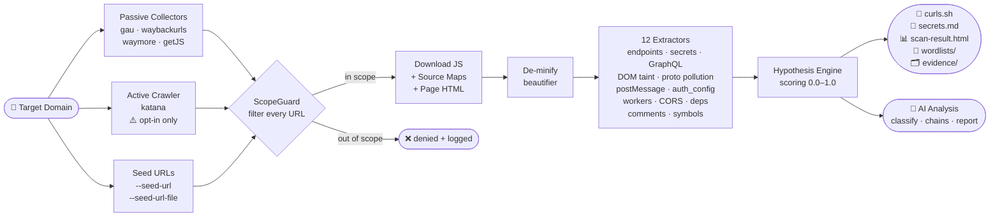
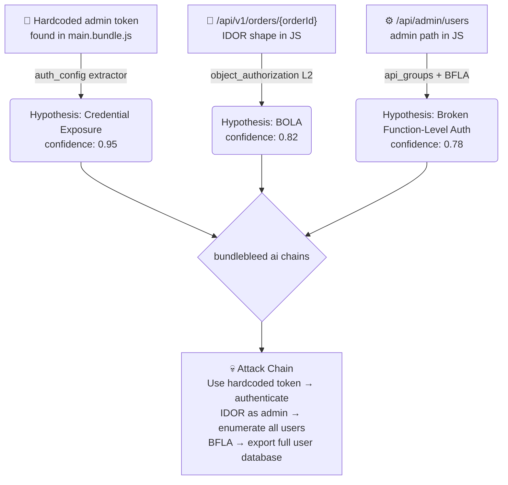
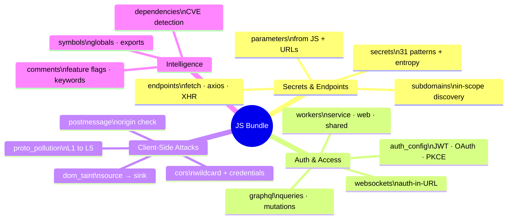

<p align="center">
  
</p>

<p align="center">
  
  
  
  
  
</p>

<p align="center">
  <b>AI-powered JavaScript recon for bug bounty hunters.</b><br>
  Point it at a domain. Get endpoints, secrets, attack chains, and a draft report — without touching production.
</p>

---

## What it does

BundleBleed collects URLs from **gau**, **waybackurls**, **waymore**, and **getJS** simultaneously, pulls every JS file, de-minifies it, runs 12 extractors, scores every finding into prioritized hypotheses, and writes a curl sheet you can run immediately. Add `--active` to also run **katana** as a JS-aware headless crawler on top.

Add `--ai` and Claude (or Ollama / OpenRouter) classifies every endpoint by bug class, drafts attack chains across findings, and writes a submission-ready bug bounty report.

Built from the ground up for serious bug bounty recon.

```bash
# Install
git clone https://github.com/shaikarifali/bundlebleed.git && cd bundlebleed && uv sync

# Run
bundlebleed scan -t target.com -o results/

# With AI
bundlebleed scan -t target.com -o results/ --ai --ai-model claude-sonnet-5-5
bundlebleed ai report <hypothesis-id> --model claude-sonnet-5-5 -o results/
bundlebleed ai chains --model claude-sonnet-5-5 -o results/
```

### How it works



### Attack chain example



---

## Output

Every scan writes:

| File | What's in it |
|------|-------------|
| `scan-result.html` | Interactive dashboard — stat tiles, sortable tables, search. Open in browser. |
| `curls.sh` | Ready-to-run curl sheet. BOLA/BFLA first, then auth-required, unauthed, GraphQL introspection. |
| `secrets.md` | Redacted secrets report — pattern-matched + entropy tokens. Never stores plaintext. |
| `per_file/` | Per-JS-file analysis with interest score. Every finding scoped to file. |
| `wordlists/urls.txt` | Every collected URL — pipe into `httpx` or Burp Intruder. |
| `wordlists/endpoints.txt` | API paths extracted from JS — pipe into `ffuf`. |
| `wordlists/parameters.txt` | Parameter names from JS + URL query strings — pipe into `arjun`. |
| `wordlists/subdomains.txt` | In-scope subdomains discovered in JS. Pipe into `httpx`. |
| `wordlists/third-party-hosts.txt` | External `<script src>` hosts — supply chain surface. |
| `scan-result.json` | Full machine-readable output. Feed into `bundlebleed ai chains`. |
| `evidence/<id>/` | Per-hypothesis evidence bundle with proposed test steps. |

---

## Extractors — what runs on every JS file




| Extractor | What it finds |
|-----------|--------------|
| `secrets` | 31 patterns: AWS/GCP/Azure keys, Stripe, Slack, Twilio, SendGrid, Discord, Square, Shopify, Mapbox, PayPal, JWT, Bearer tokens, generic `api_key = "..."`. Shannon entropy ≥4.0 sweep catches everything else. Redacted output only — never stores plaintext. |
| `endpoints` | `fetch()`, `axios()`, `$.ajax()`, `XHR.open()`, `sendBeacon()` — call-context anchored. Bare-string matching is deliberately avoided: it floods results with CSS classes and image paths on real minified bundles. |
| `graphql` | Inline `gql\`\`` queries, mutations, subscriptions. Persisted query hashes. Variables. Risk flags (introspection enabled, missing auth). |
| `websockets` | WebSocket, Socket.IO, SockJS, STOMP, graphql-ws. Auth credentials in URL. Missing `origin` check detection. |
| `auth_config` | JWT `alg:none` (unsigned — auth bypass). Decode-without-verify. `jku`/`x5u` JWKS injection references. Token in `localStorage`/`sessionStorage`. OAuth implicit flow. Missing PKCE/state. Dynamic `redirect_uri`. |
| `dom_taint` | Source-to-sink proximity analysis (35-line window): `location.search` / `location.hash` / `event.data` / `referrer` / `URLSearchParams` → `innerHTML` / `eval` / `document.write` / `location.assign` / `Function()`. |
| `proto_pollution` | L1 `__proto__` direct write → L2 `constructor.prototype` → L3 unsafe `lodash`/`jQuery` merge calls → L4 dynamic bracket write → L5 `Object.prototype` mutation. File-wide gadget detection (property reads that could be poisoned). |
| `postmessage` | Wildcard `*` senders. Receivers without `event.origin` check. Data sinks (`eval`/`innerHTML`/`location`) within 25-line window of the listener. |
| `workers` | Service worker `register()`, `skipWaiting()`, `clients.claim()`, fetch intercept. Web workers and shared workers. External `importScripts()` — a third-party URL in a service worker is a supply chain attack surface. |
| `comments` | Security keywords in `//` and `/* */` comments. Feature-flag SDK markers: LaunchDarkly, Optimizely, Unleash, splitio — reveals hidden or unreleased functionality. |
| `symbols` | `window.X`, `globalThis.X`, `export {}`, `module.exports`, top-level globals — maps the app's full client-side surface. |
| `dependencies` | CVE detection pipeline: osv-scanner → retire.js → banner-regex fallback. Flags known-vulnerable libraries by exact version. |

---

## Processors — what runs after extraction

| Processor | What it does |
|-----------|-------------|
| `object_authorization` | **BOLA/IDOR** — L1 (object ID in path/query) → L2 (connected to named function) → L3 (sensitive property in same request) → L4 (cross-tenant ID: `tenantId`, `orgId`, `accountId`). **BFLA** — admin/internal/debug path enumeration. **Mass assignment** — spread patterns (`{...body}`, `Object.assign`) combined with sensitive property names (`role`, `isAdmin`, `permissions`, `verified`). |
| `api_groups` | Groups endpoints by function: auth / user / admin / billing / search / debug / upload. Flags v1 endpoints when v2 also exists — legacy versions often have weaker auth. |
| `endpoint_tagger` | Tags each endpoint: live / historical / unauthed / auth-required. Classifies environment: prod / staging / dev. |
| `asset_graph` | Webpack / Vite / Next.js bundler detection. Root-node model with static + dynamic import edges. Vite manifest parsing. Flags endpoints only reachable after downloading the JS body vs. ones visible from the raw URL. |
| `beautifier` | De-minifies every JS file before any extractor runs. Catches patterns that only appear after variable names are restored. Uses `jsbeautifier` with graceful fallback on malformed bundles. |
| `framework_detect` | React, Angular, Vue, Next.js, Nuxt detection from signatures. Used to contextualize findings. |

---

## High-value detections

Things most JS scanners miss:

| Detection | How it works |
|-----------|-------------|
| **Source map recovery** | Follows `//# sourceMappingURL=` and fetches `.map` files. When `sourcesContent` is present, recovers the original unminified source — real variable names, comments, debug-only endpoints that never appear in the shipped bundle. Zero extra requests: the map was being fetched anyway. |
| **SSRF-shaped endpoints** | Path segments and query keys that look like server-side URL fetchers: `webhook`, `callback`, `proxy`, `targetUrl`, `redirect_url`, `fetchUrl`. Word-boundary tokenized so `profileUrl` doesn't false-positive. One of the highest-payout bug classes on HackerOne. |
| **CORS misconfiguration** | `Access-Control-Allow-Origin: *` combined with `Access-Control-Allow-Credentials: true` — spec-invalid combination caught from response headers during the normal download step. Zero extra requests, zero active probing. |
| **JWT `alg:none`** | Every matched JWT has its header decoded (never the payload) to check for an unsigned / `none` algorithm — a direct authentication bypass. Reported as critical severity with a specific test step. |
| **Firebase open database** | `firebase_config` secret pattern generates a specific "GET `<host>/.json`" test suggestion — not a generic finding. You run it, the tool never does. |
| **Client-side supply chain** | Every `<script src>` served from a third-party domain is flagged and added to `wordlists/third-party-hosts.txt`. A takeover or compromise of that host puts attacker-controlled JS directly on the target's page. |
| **Feature flag discovery** | LaunchDarkly, Optimizely, Unleash, splitio markers in comments. Hidden or unreleased functionality that isn't exposed in the UI yet — but the code and sometimes the API endpoints are already there. |
| **Auth access-control regression** | With `--history-dir`: flags any endpoint that required authentication in the last scan and is now reachable without it. The regression nobody catches until it's a P1. |
| **A→B→C attack chains** | `bundlebleed ai chains` connects findings across hypotheses: "this IDOR + this leaked admin token = full account takeover." Automated with an LLM — surfaces chains you'd otherwise miss manually. |
| **Second-order endpoint discovery** | Beautifies the JS body before extraction, then also follows HTML link/form extraction from non-JS pages. Classic server-rendered routes like `/product?productId=1` are found even when they're not JS API calls. |

---

## Hypothesis engine

Every extractor feeds the hypothesis engine. Each finding becomes a scored `Hypothesis` object with:

- **Confidence score** (0.0–1.0) — multi-factor: static pattern match, JS-body-only visibility, auth context, historical match across scans, runtime evidence, capped AI input
- **Bug class** — BOLA, BFLA, Mass Assignment, DOM XSS, Open Redirect, Prototype Pollution, Auth Bypass, SSRF, CORS Misconfiguration, Credential Exposure, Supply Chain, and more
- **Proposed test steps** — non-destructive, read-only. You run them. The tool never sends a verification request.
- **Evidence chain** — redacted JSON bundle under `evidence/<id>/finding.json`

| Hypothesis type | Signal source | Confidence |
|----------------|--------------|-----------|
| BOLA / IDOR | `object_authorization` L1–L4 | High |
| Auth Bypass | `auth_config` — `jwt_alg_none`, `decode_no_verify` | High |
| Prototype Pollution | `proto_pollution` L1–L5 | High |
| WebSocket Credential Leak | `websockets` — auth in URL | High |
| DOM XSS | `dom_taint` — source → `innerHTML`/`eval` sink | Medium |
| SSRF | endpoint `_has_ssrf_shape()` | Medium |
| CORS Misconfiguration | `cors` — ACAO: * + credentials: true | Medium |
| OAuth Misconfiguration | `auth_config` — missing PKCE, implicit flow | Medium |
| Open Redirect | `dom_taint` — source → `location.assign` | Medium |
| postMessage Injection | `postmessage` — receiver + data sink, no origin check | Low–Medium |
| Supply Chain | Third-party `<script src>` | Informational |

---

## AI features

All three AI commands work with **Anthropic**, **Ollama** (self-hosted, free), or **OpenRouter** (free tier available). AI never sees raw JS, secrets, or cookies — only redacted finding metadata.

```bash
# Classify endpoints by bug class during scan (Anthropic)
bundlebleed scan -t target.com -o results/ --ai --ai-model claude-sonnet-5-5

# Self-hosted Ollama — nothing leaves your machine
bundlebleed scan -t target.com -o results/ \
  --ai --ai-provider ollama --ai-model llama3 --ai-host http://localhost:11434

# OpenRouter free tier
bundlebleed scan -t target.com -o results/ \
  --ai --ai-provider openrouter --ai-model meta-llama/llama-3.1-8b-instruct:free

# Draft a submission-ready bug bounty report from one hypothesis
bundlebleed ai report <hypothesis-id> --model claude-sonnet-5-5 -o results/

# Suggest IDOR → auth bypass → ATO attack chains across all findings
bundlebleed ai chains --model claude-sonnet-5-5 -o results/

# Dry run — see what would be sent, spend zero tokens
bundlebleed scan -t target.com -o results/ --ai --ai-model claude-sonnet-5-5 --ai-dry-run
```

---

## All workflows

```bash
# ── Basic ──────────────────────────────────────────────────────────────────
bundlebleed scan -t target.com -o results/
bundlebleed scan -t target.com,api.target.com -o results/
bundlebleed scan -tL scope.txt -o results/
bundlebleed scan --config scope.yaml -o results/

# ── SPA / JS-heavy targets with no archive history ─────────────────────────
bundlebleed scan -t app.target.com \
  --seed-url https://app.target.com/dashboard -o results/
bundlebleed scan -t app.target.com --seed-url-file seeds.txt -o results/

# ── Authenticated (cookies you already have — no login performed) ──────────
bundlebleed scan -t target.com \
  --session "session=abc123; csrf=xyz789" -o results/
bundlebleed scan -t target.com --cookie-file ./cookies.json -o results/

# ── Continuous monitoring (run from cron/CI) ───────────────────────────────
bundlebleed scan -t target.com -o results/ \
  --history-dir ./.bundlebleed-history \
  --webhook https://hooks.slack.com/services/...

# ── Runtime browser capture (headless Chromium) ────────────────────────────
# Requires: uv pip install 'bundlebleed[runtime]' && playwright install chromium
# Requires: scope.yaml with authorization.attested: true + --active flag
bundlebleed scan --config scope.yaml -o results/ --active --runtime-capture

# ── Draft IDOR verification curl pairs ────────────────────────────────────
bundlebleed scan --config scope.yaml -o results/ --active --draft-verification
bundlebleed verify diff --baseline resp-baseline.json --test resp-test.json
bundlebleed verify record <hypothesis-id> --outcome confirmed -o results/

# ── Scope check ───────────────────────────────────────────────────────────
bundlebleed scope check "https://api.target.com/v1/users" -t target.com
bundlebleed scope list -tL scope.txt
```

---

## Scope config

```yaml
# scope.yaml
scope:
  in_scope:
    - domain: target.com
      type: wildcard    # matches target.com AND *.target.com
    - domain: api.other.com
      type: exact
  out_of_scope:
    - blog.target.com
  excluded_paths:
    - /admin/*

authorization:
  attested: false       # set true to unlock --active and --runtime-capture

scan:
  requests_per_second: 2
  delay_between_domains: 1.0
```

Every URL — including seed URLs — goes through ScopeGuard before it's used. A URL outside the declared scope is denied and logged, never a silent bypass.

---

## Install

Requires Python 3.12+ and [uv](https://github.com/astral-sh/uv).

```bash
git clone https://github.com/shaikarifali/bundlebleed.git
cd bundlebleed
uv sync

# Optional — runtime browser instrumentation
uv pip install 'bundlebleed[runtime]'
playwright install chromium
```

---

## Development

```bash
uv run pytest                        # 576 tests, no live network calls
uv run ruff check .
uv run mypy --strict bundlebleed
```

---

## Legal

For authorized security testing only. Obtain written permission before running against any target. Unauthorized access to computer systems is illegal. The authors are not responsible for misuse.
